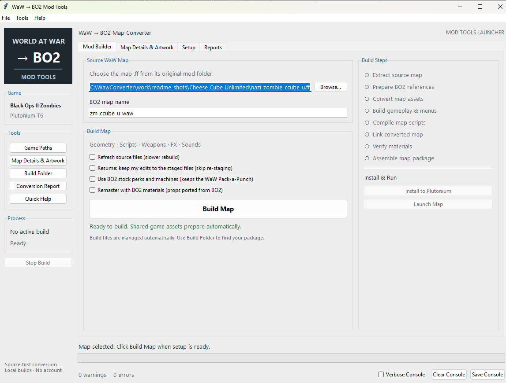
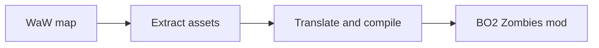
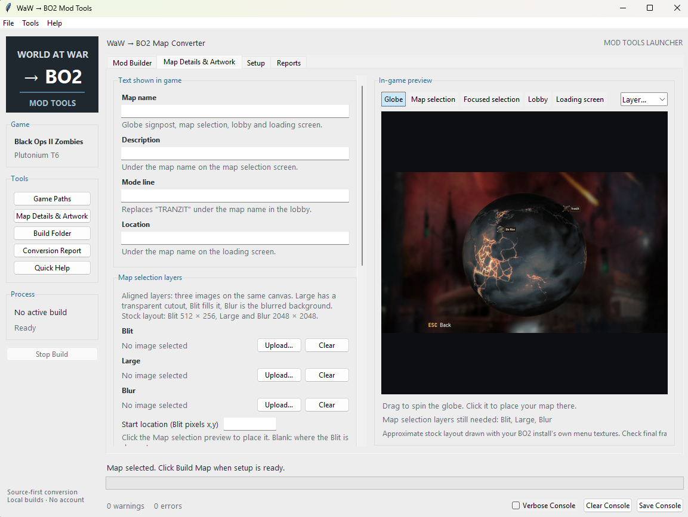

# B2W

Convert **World at War** custom Zombies maps into **Black Ops II** Zombies mods for Plutonium T6.

**[Download for Windows](https://github.com/Ticass/B2W/releases/latest/download/WawConverter-Windows.zip)** · **[Download for Linux](https://github.com/Ticass/B2W/releases/latest/download/WawConverter-Linux-x86_64.tar.gz)** · [Map compatibility](https://ticass.github.io/B2W/)

## Build your first map

You’ll need World at War, Black Ops II, BO2 Mod Tools, and Plutonium T6.

1. Extract the download and open `WawConverter.exe` on Windows. On Linux, follow the [Linux setup guide](docs/LINUX.md).
2. Check your game paths in **Setup**, then select the map’s main `.ff` from its original WaW mod folder.
3. Click **Build Map**. When it finishes, choose **Install to Plutonium**, then **Launch Map**.

The first build prepares shared game assets. Compatibility varies by map. The **Reports** tab shows what converted and what needs attention.

## From WaW to BO2

## Make it yours

Set the map’s title, location, and artwork, then preview how they’ll look in BO2’s menus.

[Desktop guide](docs/DESKTOP.md) · [Setup and troubleshooting](docs/USAGE.md) · [Release notes](CHANGELOG.md) · [Development](docs/DEVELOPMENT.md)
